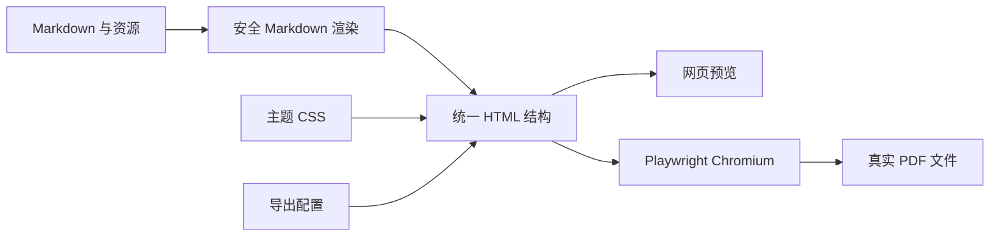

# AGENTS.md

本文件适用于仓库根目录及其所有子目录。进入本项目的新会话必须先完整阅读本文件与 `docs/PROGRESS.md`。

## 1. 语言与沟通

- 所有解释、询问、进度汇报、提交说明和项目文档必须使用简体中文，代码及必要的技术标识除外。
- 涉及架构调整、新功能模块或明显改变现有实现方向时，先用文字或 Mermaid 对齐设计，等待用户确认后再编码。
- 开始实质性任务前列出任务清单，等待用户明确确认。
- 修改、新建或删除文件前，简要说明具体变更范围，等待用户确认。
- 代码量较大或逻辑复杂时分步执行；每完成一个阶段，汇报结果并等待用户确认是否继续。
- Mermaid 中的中文标题和节点文字必须使用英文双引号包裹。

## 2. 会话启动检查

新会话、上下文压缩后或对当前目录不确定时，在执行其他 Shell 命令前先确认仓库根目录。不得假设固定绝对路径或盘符——协作环境可能是 Windows、macOS 或 Linux，克隆位置因机器而异。可用如下只读方式确认（按当前 Shell 语法改写等价命令）：

```text
git rev-parse --show-toplevel
```

随后依次执行只读检查：

```text
git status --short
git log --oneline -5
读取 docs/PROGRESS.md（显式使用 UTF-8 编码）
```

当前工作区可能包含用户或上一个会话留下的未提交修改。禁止使用 `git reset --hard`、`git checkout --`、`git clean` 等方式丢弃修改，除非用户明确要求。

## 3. Shell 与文件操作

- 不假设固定 Shell 类型（PowerShell、bash、zsh 等均可能）；命令语法跟随当前会话实际使用的 Shell，禁止把某一种 Shell 的专属语法当作硬性要求写入产物、脚本或文档。
- 不要通过绝对路径 `cd` 前缀拼接命令；工具支持时优先使用 `workdir`。
- 子目录操作使用相对路径或直接设置 `workdir`。
- 读取、写入、追加或替换文本文件时显式指定 UTF-8 编码。
- 本地文件修改优先使用补丁工具，避免使用不透明的大段覆盖命令。
- 不执行破坏性删除；如确需删除，先确认精确目标并向用户说明。

## 4. 项目目标

本项目是一个可在内网部署的 Markdown 排版与 PDF 导出工具，目标包括：

- 浏览器选择或编辑 Markdown；
- 使用服务端统一渲染 Markdown；
- 网页预览和 PDF 使用同一份 HTML、主题 CSS 与资源；
- 使用固定版本 Chromium 生成真实、可搜索的 PDF 文件；
- 支持纸张尺寸、方向、页边距、页眉、页脚和多种页码样式；
- 支持主题清单与 CSS 主题扩展；
- 支持 Front Matter、表格、任务列表、脚注、代码高亮、KaTeX、Mermaid 和 ECharts；
- 提供 Web 与 Electron 桌面端，共用渲染、主题和分页核心；
- 使用 Docker Compose 在内网部署；
- 文档只在当前请求中临时处理，不建立文档历史数据库。

核心渲染链路：



## 5. 技术架构

- 前端：React、TypeScript、Vite。
- 后端：Node.js、TypeScript、Fastify。
- 桌面端：Electron、electron-builder、NSIS。
- 应用服务：`packages/application`。
- 共享模型：`packages/core`。
- Markdown 渲染：`packages/renderer`。
- 连续预览与分页引擎：`packages/preview-engine`。
- ECharts 协议与运行时：`packages/markdown-echarts`。
- PDF 引擎：Web 使用固定版本 Playwright Chromium，桌面端使用 Electron Chromium。
- Markdown：markdown-it 及 `@mdit/plugin-*` 插件。
- 元数据：gray-matter。
- 安全过滤：sanitize-html。
- 代码高亮：highlight.js。
- 数学公式：KaTeX。
- 图表：Mermaid、ECharts。
- 校验：Zod。
- 测试：Vitest。
- 部署：Docker、Docker Compose。

主要目录职责：

```text
apps/web/             前端编辑、配置与预览界面
apps/server/          HTTP API、主题读取和 Playwright PDF 服务
apps/desktop/         Electron 桌面壳、IPC、原生文件与 PDF 能力
packages/application/ 共享应用服务、主题注册和图片资源处理
packages/core/        导出配置和主题清单等共享模型
packages/renderer/    Markdown 到安全 HTML 的渲染管线
packages/markdown-echarts/ ECharts YAML 协议、验证和浏览器 SVG 运行时
packages/preview-engine/ 连续预览、增量分页、媒体适配和 Paged.js 运行时
themes/               内置主题
deploy/               Docker、Compose、Nginx 和部署文档
docs/                 进度、架构和部署文档
```

## 6. 必须保持的实现约束

### 6.1 预览与 PDF 一致性

- 预览和 PDF 必须复用 Markdown 渲染结果、`#write` DOM、主题 CSS 和打印 CSS。
- 不允许前端和 PDF 服务分别维护两套 Markdown 解析逻辑。
- PDF 使用容器中固定版本的 Chromium，确保不同部署环境结果可复现。
- Mermaid、字体、图片和公式完成渲染后，才能调用 PDF 输出。

### 6.2 主题扩展

- 主题通过版本化 `theme.json` 清单接入，不在业务代码中写死主题行为。
- 主题负责字体、颜色、标题、表格、引用、代码块等视觉样式。
- 纸张、页边距、页眉页脚、页码和 PDF 元数据属于导出配置，不属于主题。
- 主题需要声明作者、版本、许可证、DOM 预设和支持能力。
- 第三方主题资源必须先在 `themes/THEME_NOTICE.md` 中登记来源与作者，并保留其 `theme.json` 中的署名信息。
- 可以自行实现视觉接近的主题，也可以引入已登记的第三方主题资源。

### 6.3 安全与隐私

- 默认不保存用户 Markdown、图片或生成历史。
- 资源上传和 PDF 生成使用每请求独立临时目录，并在 `finally` 中清理。
- 阻止 `../` 路径穿越、任意本地文件读取和符号链接越界。
- Markdown 原始 HTML 默认不执行；渲染结果必须经过安全过滤。
- Mermaid 使用严格安全模式。
- 自定义 CSS、远程图片和远程字体需要限制网络访问，避免信息泄漏和 SSRF。
- 对 Markdown、资源数量、单文件大小、总大小、渲染时间和 Chromium 并发设置上限。

### 6.4 页眉页脚与页码

- 普通页眉页脚优先使用 Chromium 的 header/footer template。
- 模板样式必须内联，不假设继承正文 CSS。
- 基础页码支持当前页、总页数、中英文组合及左右中位置。
- 罗马数字、章节页码、封面不计页码等复杂能力放在 PDF 后处理扩展层，不阻塞首版。

## 7. 开发和验证

要求 Node.js 22 或更高版本。

安装依赖：

```text
pnpm install
```

本地开发：

```text
pnpm run dev
```

完整验证：

```text
pnpm test
pnpm run typecheck
pnpm run build
```

任何功能提交前至少满足：

- 相关单元测试通过；
- 全项目类型检查通过；
- 生产构建通过；
- `git diff --check` 无空白错误；
- 未意外纳入 `node_modules`、`dist`、临时文件或用户文档。

如涉及 PDF 输出，还必须使用包含中文、长表格、代码块、公式、Mermaid、图片和分页边界的样例进行端到端验证，并对生成 PDF 做页面渲染检查。

## 8. Git 规范

- 默认分支为 `main`。
- 提交前先检查 `git status --short` 和 `git diff`。
- 不覆盖或混入与当前任务无关的用户修改。
- 一个提交只表达一个清晰阶段。
- 提交信息前缀使用标准英文，正文使用简体中文，例如：

```text
feat: 实现网页实时预览
fix: 修复表格跨页断裂
docs: 更新内网部署说明
chore: 初始化项目骨架
```

- 不修改或重写已有提交，除非用户明确要求。
- 版本标签必须指向专门的发布提交。发布提交信息使用标准英文前缀
  `release:`，简体中文正文必须完整列出该版本的新增能力、问题修复、
  兼容性或部署变化、验证结果和发布产物，不得只写版本号或简略摘要。
- 版本标签使用 annotated tag；标签说明应与发布提交正文保持一致，完整
  记录本版本更新，不得使用只有版本号的标签说明。

## 9. 当前交接入口

项目的实时状态、已完成内容、未提交修改和下一步顺序以 `docs/PROGRESS.md` 为准。新会话不得仅凭 Git 提交标题判断进度。
