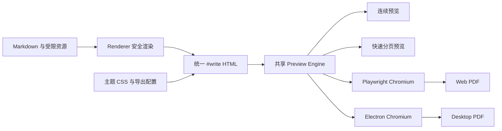

# 墨呈

> 一稿多式，即写即呈

面向结构化 Markdown 的主题化文档创作与发布工具，同时提供 Web 与
Windows 桌面端。预览与 PDF 复用同一份安全 HTML、`#write` DOM、主题
CSS 和分页运行时，DOCX 使用同源语义文档、主题令牌和可编辑 OOXML。

当前版本：`v0.6.0`。

## v0.6.0 核心更新

- 新增可编辑 DOCX 导出，使用固定 Pandoc、动态 Word 样式、原生分节、
  页眉页脚、页码和高分辨率 PNG 媒体管线；
- 主题 CSS 通过通用语义槽位翻译为 Word 样式，支持 14 套内置主题、
  公文结构、独立封面、代码、表格、图片、Mermaid 与 ECharts；
- 新增 CodeMirror 6 Markdown 工具栏，支持标题、行内格式、引用、列表、
  代码块、分隔线和尺寸表格；
- 产品品牌升级为“墨呈”，Windows 主程序和发行产物使用英文名
  `MorphDoc`。

## v0.5.1 主题与公文能力

- 新增政企标准红头、函件红头、企业简版红头、简报红头等 4 套红头主题，
  以及 3 套正式文档主题和 3 套标书主题；
- 正式主题可声明推荐页边距、页眉页脚、页码和页面装饰；未声明时继续使用
  16mm 默认页边距，选择正式主题时自动采用其规范参数；
- 新增公文、项目报告和标书结构化 Front Matter，支持发文机关、文号、
  签发人、密级、主送、抄送、印发信息、封面及落款等文档结构；
- 内置方正书版兼容的 Fandol 中文字体资源，统一正文、红头标题与页眉页脚
  字体，并修复红头标题居中；代码块支持按正文宽度自动换行、跨页分片，
  同时保留 `8px` 左侧内容留白；
- 内置 ECharts 与公文主题教程，并为 14 套主题提供示例 Markdown；
  Desktop 发行包包含全部教程和示例，打开示例时自动切换相应主题；
- “更多”菜单按文件、教程与示例、主题管理分区；Desktop 新增
  `Ctrl+N/W/S/Shift+S` 工作流、未保存确认及跟随新路径的“另存为”，
  Web 端隐藏不适用的“另存为”。

## Web 与桌面端

| 能力 | Web / Docker | Windows Desktop |
| --- | --- | --- |
| 新建 Markdown | 支持 | 支持 |
| 打开 Markdown | 浏览器文件选择 | 原生对话框、文件关联、第二实例转交 |
| 保存文件 | 浏览器下载 | 原生保存与另存为 |
| 相对本地图片 | 默认不支持 | 以 Markdown 所在目录为安全边界 |
| 文档内锚点 | 当前预览定位 | 当前预览定位 |
| HTTP/HTTPS 链接 | 浏览器新窗口 | 系统默认浏览器 |
| 本地文件链接 | 不执行 | 相对、绝对路径及 `file:` URI 均可尝试打开 |
| 多文件 | 当前浏览器文档 | 多窗口、同一文件单例 |
| 外部文件变化 | 不适用 | 窗口聚焦时提示重新加载 |
| 远程图片 | 服务端受限下载并内嵌 | 应用服务受限下载并内嵌 |
| 自定义主题 | Compose 只读挂载目录 | “更多 → 打开自定义主题目录” |
| PDF 引擎 | 固定版本 Playwright Chromium | Electron 自带 Chromium |
| DOCX 引擎 | 固定版本 Pandoc | 内置固定版本 Pandoc |

Web 端不提供本地素材目录能力。需要包含本地相对资源的文档时，请使用
Desktop；Web 端可使用 Base64/Data URL 或受限公网图片。

## 渲染架构



连续预览适合高频编辑；快速预览提供客户端分页反馈；精确预览直接展示
服务端生成的 PDF，是 Web 最终分页的权威结果。桌面 PDF 复用相同分页
载荷和运行时。

## 项目目录

```text
apps/
  web/                  React 编辑、设置、快速/精确预览与浏览器文件操作
  server/               Fastify API、Playwright PDF 与容器运行入口
  desktop/              Electron 主进程、IPC、原生文件和 Windows 打包
packages/
  core/                 跨端文档、导出配置和主题协议
  renderer/             Markdown 到安全 #write HTML 的渲染管线
  application/          共享渲染、主题注册和图片资源应用服务
  markdown-echarts/     ECharts YAML 协议、验证与浏览器 SVG 运行时
  preview-engine/       连续预览、增量分页、媒体适配和 Paged.js 运行时
themes/                 内置主题与主题清单
deploy/                 Dockerfile、Compose、Nginx 和部署文档
docs/                   项目进度与主题开发说明
scripts/                主题导入等维护脚本
logos/                  应用图标源文件
.local/themes/          本地开发和 Compose 自定义主题目录
```

包依赖保持单向：`core` 提供基础协议和链接分类；`markdown-echarts`
提供独立图表能力；`renderer` 消费两者生成安全 HTML；`application`
组合渲染器、主题和资源用例；`preview-engine` 消费渲染结果完成连续或
分页排版；三个 `apps/*` 只负责平台界面、传输、链接动作与 PDF 适配。

各包的目录和用法：

- [application](packages/application/README.md)
- [core](packages/core/README.md)
- [renderer](packages/renderer/README.md)
- [markdown-echarts](packages/markdown-echarts/README.md)
- [preview-engine](packages/preview-engine/README.md)

## 本地开发

要求 Node.js 22 或更高版本。

```powershell
pnpm install
pnpm run dev
```

默认地址：

- Web：http://localhost:5173
- API：http://localhost:3001
- 健康检查：http://localhost:3001/api/health

桌面端开发：

```powershell
pnpm run desktop:dev
```

桌面端目录包和 Windows 安装包：

```powershell
pnpm run desktop:package
pnpm --filter @morphdoc/desktop run make
```

桌面 `package` 和 `make` 会先完整重建内嵌 Web 及全部共享依赖，再准备并
校验固定 Pandoc `3.9.0.2` 最小运行时，不能复用陈旧的
`apps/web/dist`。产物位于 `apps/desktop/out/v0.6.0/`。
正式安装包命名为 `MorphDoc-0.6.0-x86_64-Setup.exe`，同时生成免安装 ZIP；当前发行包
未配置代码签名。

## 文档与媒体

Markdown 支持 Front Matter、表格、任务列表、脚注、highlight.js、
KaTeX、Mermaid 和安全的 ECharts YAML 围栏。

独立一行的 `` 会生成带标题的图片块。分页引擎将图片、
Mermaid、ECharts 及其紧邻标题视为不可拆分媒体块，并按文档顺序串行
计算。图片的缩放基准是原图先收缩到内容限宽后的高度；需要回填上一页时
只缩放媒体内容，不缩放标题。这样可利用接近可容纳的页尾空白，同时避免
跨页、重复重排和后续媒体顺序变化。

ECharts 围栏语法、支持系列和安全边界详见
[markdown-echarts 包文档](packages/markdown-echarts/README.md)。

## 主题

仓库内置 4 套 Markdown 排版风格主题、4 套红头主题、3 套正式文档主题和
3 套标书主题，默认使用 GitHub。主题由版本化
`theme.json` 清单、主体 CSS、可选基础 CSS、打印 CSS 和资源组成。

- 本地开发与 Compose：将主题目录放入 `.local/themes/`；
- Desktop：从“更多 → 打开自定义主题目录”打开实际安装目录，再放入主题；
- 主题格式、安全限制和资源引用详见[主题开发指南](docs/THEMES.md)。

Compose 会把 `.local/themes` 只读挂载到容器。主题导入脚本只用于
刷新本地开发副本：

```powershell
pnpm run theme:import-typora
```

## Docker Compose 部署

```powershell
docker compose -f deploy\compose.yaml up --build -d
```

默认访问 http://localhost:8080。端口、镜像、主题挂载、PDF 并发和超时
配置详见 [AIO 容器部署说明](deploy/README.md)。

## 验证

```powershell
pnpm test
pnpm run typecheck
pnpm run build
git diff --check
```

涉及分页或 PDF 的改动还应使用包含中文、长表格、代码、公式、图片、
Mermaid、ECharts 和分页边界的示例完成 Web、Compose 与 Desktop 端到端
验证，并检查 PDF 页面渲染结果。

## 安全与隐私

- 不建立 Markdown、图片或 PDF 历史数据库；
- 文档和资源只在当前请求或当前桌面会话中处理；
- Markdown 原始 HTML 不执行，输出经过白名单过滤；
- Mermaid 使用严格安全模式，ECharts 只接受受限纯数据 YAML；
- 本地资源阻止路径穿越和符号链接越界；
- 远程资源阻止内网地址，并限制数量、单文件大小、总大小和超时；
- PDF 页面阻止未授权外部网络访问。

当前实现与交接状态详见 [docs/PROGRESS.md](docs/PROGRESS.md)。
