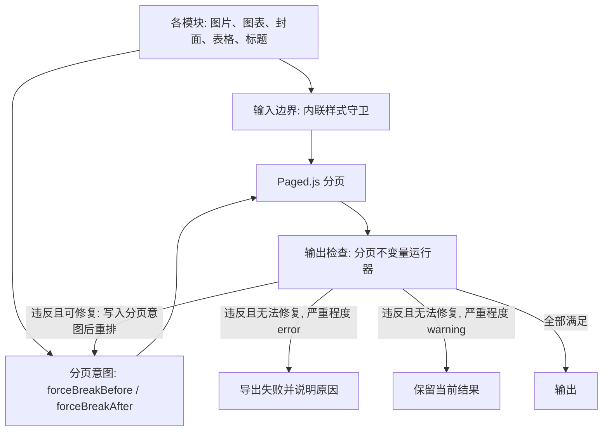

# 分页适配层

本文说明 `packages/preview-engine` 如何驾驭 Paged.js：它的行为在哪些地方与直觉不符，项目因此建立了哪几层适配，
如何扩展，以及目前已知的限制。分页是预览与 PDF 一致性的核心（见 [AGENTS.md §6.1](../AGENTS.md)），改动这里之前请先读完本文。

## 1. 为什么需要适配层

Paged.js 是第三方分页引擎，实测有几处行为与直觉不符。过去各模块各写各的补丁，同一类根因被反复遇到、各修一遍，
最终表现为表格整体被推到下一页、续页空白并整表重放、标题孤零零留在页底。现在把这些知识收敛到几个明确的层次，
让“怎么对 Paged.js 说话”和“分页之后检查什么”都只有一个入口。

## 2. Paged.js 的行为契约

下面五条都是**实测结论**，不是文档保证。升级 Paged.js 后，它们是需要重新评估的假设。固化程度并不相同：

- 第 1、2 条由 `e2e/tests/pagination-contract.spec.ts` 在真实浏览器里**直接固化**；
- 第 3 条由同一文件里的内联样式守卫用例**间接固化**（关闭守卫时该用例失败）；
- 第 4 条由连续标题的用例**间接固化**（关闭孤立标题不变量时失败）；
- 第 5 条没有测试，仅作记录。

| # | 行为 | 后果 |
| --- | --- | --- |
| 1 | `break-before`、`break-after` 只从 **CSS 规则**解析，元素上的**内联样式被完全忽略** | 内联写法对分页没有任何作用 |
| 2 | 用“语义属性 + 共享 CSS 映射规则”可以强制换页，对段落和表格行都有效，续页自动重复表头；文档首个元素之前、最后一个元素之后不产生空白页 | 强制分页必须走属性加规则 |
| 3 | 内置 `UndisplayedFilter` 把**所有带内联 `style` 的元素**标成 `data-undisplayed`，随后被 `displayedElementAfter` 跳过 | 带内联样式的表格被误判为不显示 |
| 4 | `break-after: avoid` 只在**相邻两个元素**之间生效 | 连续标题、表格内断开时失效 |
| 5 | 按文字内容定位断点；一段**周期性重复**的文字塞进超高单元格会让定位错位而空转 | 属 Paged.js 自身限制，不是项目缺陷 |

第 3 条是最初那个缺陷的根因：稳定化会给表格写 `style="table-layout: fixed"`，表格因此被跳过，标题的
`avoid` 标记落到表格**之后**的图表上；图表放不下时断点回退越过整张表，表格被整体推走（标题留在原页），
续页则出现空页和整表重放。

## 3. 三层结构

| 层 | 模块 | 职责 |
| --- | --- | --- |
| 输入边界 | `paged-inline-style-guard.ts` | 在内置过滤器运行前暂存内联样式、运行后原样还原，避免被误判为不显示；真正的 `display: none` 仍被标记 |
| 分页意图 | `paged-break-control.ts` | `forceBreakBefore` / `forceBreakAfter` 在元素上写语义属性，`pagedBreakControlCss` 把它映射成 Paged.js 认识的规则；**强制分页的唯一入口** |
| 输出检查 | `paged-pagination-invariants.ts` | 声明式不变量清单：检测、可选修复、统一的轮数上限与失败报告 |

不变量的具体实现：

| 不变量 | 模块 | 严重程度 | 修复方式 |
| --- | --- | --- | --- |
| 表格正文行不得丢失 | `paged-table-handler.ts` | error | 缺失的行换页后重排 |
| 表格正文行不得被整行重复排版 | `paged-table-handler.ts` | error | 只检测，无法通过换页修复 |
| 标题不得孤立在页末 | `paged-stranded-headings.ts` | warning | 让孤立标题（连续标题只取第一个）换页 |

分页之前的规范化与共享抽象：

| 模块 | 职责 |
| --- | --- |
| `paged-table-fit.ts` | 比页面内容区更宽的表格：先压缩单元格横向内边距，仍超宽则按比例缩列；在冻结列宽之前完成 |
| `diagram-page-fit.ts` 的 `getPrecedingHeadingChain` | “媒体块 + 它前面整串连续标题”是不可拆分的整体；整页缩放的高度计算、回填的媒体组顶部、回填的强制换页判定共用它 |

## 4. 完整分页的流程

两点说明：

- 适配页宽必须先于行高判定，因为压缩内边距会改变行高，先判定会得到过期的“整行保持”标记。
- 媒体回填会改变版面，所以回填之后要再确认一次不变量。

### 严重程度

- `error`：输出内容不正确（行丢失、重复），导出中止。
- `warning`：只是版面瑕疵（标题落在页末），修复不了时保留当前结果，不让导出失败。

### 运行时选项

| 选项 | 默认 | 说明 |
| --- | --- | --- |
| `fitTablesToPageWidth` | 开启 | DOCX 路径显式关闭：表格列宽要与 Word 的表格模型对应，不能为适应页面而被改动 |
| `allowIncompleteTableGeometry` | 关闭 | DOCX 借用分页布局测量表格几何，允许降级；同时不启用孤立标题不变量，因为页面不会呈现给读者 |

## 5. 如何扩展

**需要强制分页**：调用 `forceBreakBefore(element)` 或 `forceBreakAfter(element)`，不要写
`element.style.setProperty("break-…")`。`tests/forced-break-source-guard.test.ts` 会扫描源码并拒绝新增的内联写法；
白名单里每一项都写明了真实状态，写入次数变化也会使测试失败。

**需要新的分页后检查**：实现 `PaginationInvariant`，加入 `paged-document-runtime.ts` 里 `paginateFully` 的清单。
修复函数必须幂等：对已经施加过修复的对象返回 0，运行器据此判断无法继续改善，避免空转。随后补单测、
e2e，并做反向验证（见下一节）。

**需要判断“媒体块前面有哪些标题”**：用 `getPrecedingHeadingChain`，不要自己取 `previousElementSibling`。

## 6. 测试体系

happy-dom 没有布局引擎，单测只能验证判定逻辑和结构，**分页效果必须在真实浏览器里验证**，所以分成两层：

| 层 | 位置 | 验证什么 |
| --- | --- | --- |
| 单元测试 | `packages/preview-engine/tests/` | 判定逻辑、属性写入、幂等性；几何用桩 |
| 契约测试 | `e2e/tests/pagination-contract.spec.ts` | 第 2 节的前四条行为；内联样式守卫在真实 Paged.js 里的效果 |
| 内容守恒 | `e2e/tests/content-conservation.spec.ts` | 对全部静态夹具、四组主题与纸张配置（三个主题，含 A4、A3 横向、A5 横向）：分页前后文字逐字一致、媒体块个数相等、整行不重复、无空白页、标题不孤立、Paged.js 不报 `Unable to layout item` |
| 专项 | `e2e/tests/table-fit.spec.ts`、`media-fit.spec.ts`、`preview.spec.ts` | 表格适配页宽的列数扫描、整页缩放的媒体块、连续标题、被约束的封面、表格与图表的分页接缝 |

内容守恒检查是最通用的一道防线，它不依赖任何已知缺陷的具体形态。比对时排除 `thead`（续页会重复）、
`.mermaid`、`.md-echarts`（分页前后分别是源码与矢量图）和脚本样式，因此图表被重复渲染文字上看不出，
单独核对媒体块个数。

夹具里触发分页缺陷的结构由 `fixtures/markdown/generate.mjs` 的 `generateTableChartSeam` 确定性生成，
`packages/renderer/tests/fixture-matrix.test.ts` 守住两件事：静态夹具与生成器输出逐字节一致；
每个小节仍是“标题后直接接表格、表格后紧接图表”。后者不能被“改进”成在标题与表格间插入段落，那会让夹具失去触发能力。

### 反向验证

测试“通过”不等于测试有效。新增机制后必须做反向验证：

1. 临时关闭该机制（注释掉注册或改一处判断）并重新构建；
2. 运行全部 e2e，**对应的用例必须失败**，且只有它们失败；
3. 恢复源码，并校验与备份逐字节一致，再重新构建；
4. 把新增的 e2e 原样跑在上一个正式版的构建上，确认它们能抓住旧缺陷。

## 7. 已知限制与待优化项

状态说明：**已知缺陷**是用户可见的版面瑕疵；**待优化**是不影响正确性、可在小版本迭代的改进；**设计限制**是有意的取舍。

| 编号 | 类别 | 内容 | 方向 |
| --- | --- | --- | --- |
| PG-1 | 已知缺陷 · 可优化 | **列表项的引导行落在页底，子项在下一页。** 例如可研主题 A3 横屏的研报第 32 页末，“4. 远期期权（控制仓位、跟踪试点节奏）：”是页上最后一行，它的子项排到了下一页。上一个正式版的同一位置没有此现象，是内容后移后页边界恰好落在这里 | 把“列表项首行落在页底”纳入不变量，让该 `li` 换页；需要先设计：换页意图要落在 `li` 上并保持序号连续 |
| PG-2 | 待优化 · 小版本迭代 | **整页缩放的图片、图表、流程图仍用内联 `break-after` 与零高度占位标记**，对 Paged.js 无效，靠“缩放后撑满一页、后续内容自然溢出”才表现正确。已评估迁移到 `forceBreakAfter`：单个标题时迁移前后逐页一致、PDF 文字一致；连续标题的情形下，迁移曾让流程图额外重复渲染（该情形下图表本来就在重复，根因是整页缩放只扣除紧邻的一个标题，此后已由 `getPrecedingHeadingChain` 修复），**但修复之后没有重新评估迁移** | 用当前构建重新评估；通过后删除 `ensurePageBreakAfter` 与占位标记，更新 `forced-break-source-guard.test.ts` 白名单，并与上一个正式版并排对照。**封面锚点不在此列，不能迁移**（见 PG-8） |
| PG-3 | 设计限制 | 快速预览的**增量编辑路径**没有接入分页不变量，只有完整分页（PDF、精确预览、首次预览）生效。与“快速预览是编辑期间的客户端近似分页”的既有定位一致 | 若要对齐，需要让增量分页在后缀重算后同样运行不变量，并处理稳定前缀被修复改动的情形 |
| PG-4 | 设计限制 | **窄页面下标题串加表头与首行比一页还高时，标题无处可去。** A5 横向、15 列表格：标题串 137px、表头 142px、首行 142px，共约 421px，页面内容区只有 370px。不变量按设计跳过这种情形，否则只会在下一页再次孤立 | 表格在窄页面自动缩小字号，或允许表头与首行跨页拆分 |
| PG-5 | 设计限制 | 超宽表格**只保证不溢出页面、不把行切开**，不保证好看：A4 竖向放 21 列时数字会被逐位折行 | 超过阈值的列数建议改用横向纸张；或为超宽表提供转置、分栏等版式 |
| PG-6 | 设计限制 | 孤立标题检测只处理文档根容器的**直接子级**，嵌套在引用、列表、封面里的标题不干预 | 如有需要，把检测下沉到列表项和引用内部 |
| PG-7 | 设计限制 | 单元格里放**周期性重复的长文字**（同一句话重复数百遍）会让 Paged.js 定位错位而空转；在上一个正式版上同样如此，不是新引入的。真实文档几乎不会出现 | 无；测试夹具刻意避免这种内容 |
| PG-8 | 保留的死代码 | 仍有几处内联强制分页对 Paged.js 无效，保留并写明原因：**封面锚点**（约束后的封面只比页面矮 8px，零高度锚点常被挤到下一页，改成强制换页会多出空白页，A5 横向投标封面实测 4 页变 5 页）、**整页媒体**（即 PG-2）、**标题的 `avoid`**（共享 CSS 已对 h1–h6 声明同样规则，重复且无副作用） | 见 PG-2；其余保持现状 |

另外，**整行高度超过一页的表格行允许被切成多段**（`data-morphdoc-table-row-keep-whole="false"`），这是设计如此：
重复行检测只统计“整行保持不拆”的行，并且要求出现多次的文字完全相同才算重复，因为被切开的两段文字不同。
