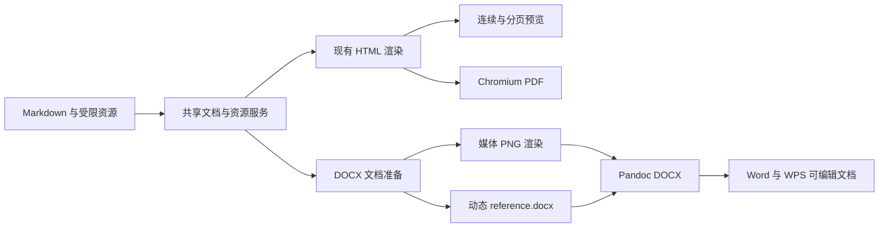

# v0.6.0 DOCX 导出与 Markdown 工具栏设计

状态：阶段 1～4 已完成，DOCX 共享协议和 Markdown 编辑器基础能力已经
落地。

## 1. 版本目标

`v0.6.0` 包含两个核心功能：

1. 新增可由 Microsoft Word 和 WPS 正常打开、编辑、保存的 DOCX 导出；
2. 将左侧原生文本框升级为 CodeMirror 6，并增加可扩展的基础 Markdown
   工具栏。

本版本不改变现有 Markdown 渲染、连续预览、分页预览和 PDF 导出链路。
DOCX 是与 PDF 并列的新输出适配器，不以 HTML 转 Word 的方式复用 PDF
打印结果。



## 2. 发布门禁

DOCX 功能必须同时满足以下两条门禁，否则不能作为 `v0.6.0` 正式能力
发布。

### 2.1 纸张与样式门禁

导出的 DOCX 必须保留当前导出配置和主题中有明确 Word 语义的属性：

- 纸张尺寸；
- 横向或纵向；
- 上、右、下、左页边距；
- 页眉、页脚和基础页码；
- 正文与标题的中西文字体、字号、颜色和字重；
- 段落对齐、行距、段前、段后和首行缩进；
- 标题 1～6；
- 引用、列表、任务列表、表格和代码块；
- 图片、图片标题、Mermaid 和 ECharts；
- 链接、脚注和可转换为 OMML 的数学公式。

同一输入在固定 Pandoc 版本和相同配置下应生成结构稳定的 OOXML。DOCX
与 PDF 使用不同的排版引擎，不要求两者逐页分页完全一致。

### 2.2 可编辑性门禁

导出的文档必须：

- 可由当前支持范围内的 Microsoft Word 和 WPS 无修复提示地打开；
- 正文、标题、列表、表格、链接、脚注和公式保持原生 OOXML 结构；
- 文本可选择、修改、复制和重新排版；
- 图片可移动、缩放、删除和替换；
- 在 Word 或 WPS 中编辑并保存后，可由另一应用再次打开；
- 不以整页截图、整篇图片或 HTML `altChunk` 作为正文实现。

Mermaid 和 ECharts 在 DOCX 中是高分辨率 PNG，不是 Office 原生图表对象。
它们可以作为图片编辑，但不能在 Word 或 WPS 中修改图表数据。

## 3. “完整样式映射”的定义

CSS 和 WordprocessingML 不是等价排版模型。“完整样式映射”在本项目中
定义为：对项目声明支持的文档语义和可转换样式建立确定性映射，而不是
承诺转换任意浏览器 CSS。

### 3.1 必须映射

| Markdown/主题语义 | DOCX 目标 |
| --- | --- |
| 正文 | `Normal` 或项目正文段落样式 |
| 标题 1～6 | Word 原生标题层级 |
| 强调、粗体、删除线、行内代码 | 字符级 OOXML 属性或字符样式 |
| 引用 | 独立段落样式 |
| 有序、无序和任务列表 | 原生编号定义与段落编号 |
| 围栏代码块 | 代码段落样式、底纹、边框和等宽字体 |
| 表格 | 原生 Word 表格、单元格和表格样式 |
| 图片与图注 | DrawingML 图片和图注段落样式 |
| 链接 | 原生超链接关系 |
| 脚注 | 原生脚注 |
| 数学公式 | Pandoc 可转换时使用 OMML |
| 分页控制 | Word 段落分页属性 |

### 3.2 尽力映射

- 简单边框、底纹、单元格内边距和表格表头样式；
- 标题的段前、段后、与下段同页；
- 图片最大宽度和图注对齐；
- 内置主题中能够转换为 Word 属性的装饰；
- 自定义主题中经安全解析后允许的字体、颜色和基础段落属性。

### 3.3 不承诺映射

- CSS 伪元素、滤镜、阴影、渐变、动画和复杂背景；
- 浏览器布局模型，如 Flex、Grid、绝对定位和复杂浮动；
- Paged.js 分页结果和 Chromium 子像素布局；
- 任意 CSS 选择器的层叠结果；
- JavaScript 生成的交互行为；
- PDF 专属打印缩放。

内置主题必须提供经过测试的 Word 样式映射。自定义主题采用受限的通用
映射；未来可以在主题清单中增加显式 DOCX 样式扩展，但不作为本阶段的
前置条件。

## 4. DOCX 技术路线

### 4.1 组件职责

```text
packages/core/
  DOCX 请求、结果、能力和错误协议

packages/application/
  文档准备、资源解析、媒体处理和导出用例

packages/docx-engine/（计划新增）
  Pandoc 调用、动态 reference.docx、OOXML 与 DOCX 验证

apps/server/
  HTTP 适配、Pandoc 运行时和并发控制

apps/desktop/
  IPC 适配、内置 Pandoc 定位和原生另存为

apps/web/
  DOCX 导出交互、状态和错误展示
```

`packages/docx-engine` 不依赖 Fastify、Electron 或浏览器 UI。Server 和
Desktop 只提供平台运行时、传输与保存能力。

阶段 3 已在 `packages/core/src/docx.ts` 建立以下跨端协议：

- DOCX 请求及 Zod Schema；
- 源图片资源；
- 固定 Pandoc 版本和运行时 capability；
- HTTP/IPC 共用错误码与错误响应；
- DOCX 结果、媒体诊断和分阶段耗时；
- MIME、扩展名和安全输出文件名。

`packages/application` 提供 `prepareDocxExport()`，统一完成请求校验、
主题查找、图片解析和 Markdown 安全渲染，并返回 DOCX 引擎需要的源请求、
渲染文档、主题清单及 CSS。该方法不调用 Pandoc。

### 4.2 转换流程

1. 校验 Markdown、主题和导出配置；
2. 在每个请求的独立临时目录准备 Markdown 和资源；
3. 将本地、远程和 Data URL 图片规范化为受控本地资源；
4. 使用现有 Chromium/Electron 图表运行时将 Mermaid、ECharts 输出为
   高分辨率 PNG；
5. 根据主题和导出配置生成动态 `reference.docx`；
6. 调用固定版本 Pandoc 生成 DOCX；
7. 检查 DOCX ZIP 和关键 OOXML 部件；
8. 返回 DOCX Buffer，并在 `finally` 中清理临时目录。

不引入 Python。Node.js 负责业务编排、OOXML 修改、资源处理、进程控制和
安全边界；Pandoc 仅作为受控的独立转换器。

### 4.3 Pandoc 分发

- 固定使用 Pandoc `3.9.0.2`，不在构建时跟随 latest；
- 开发环境允许通过 `DOCX_PANDOC_PATH` 或 `PATH` 使用相同版本；
- Docker amd64 使用官方 Linux 静态发行包，安装到
  `/opt/pandoc/3.9.0.2/`；
- Windows Desktop 将官方 ZIP 中的 `pandoc.exe`、许可证和版权文件放入
  `process.resourcesPath` 下的固定资源目录；
- 用户输入不得成为可执行路径或任意命令行参数；
- 启动时或导出前校验精确版本，并通过 capability 状态报告不可用原因；
- 发行时保留 GPL、版权声明和精确版本源码获取方式；
- Pandoc 继续作为独立子进程，不链接或导入其程序代码。

官方文件、SHA-256、路径优先级、包体实测和许可证义务见
[Pandoc 运行时与分发规范](PANDOC_DISTRIBUTION.md)。

### 4.4 动态 reference.docx

动态模板以固定 Pandoc 版本的默认 `reference.docx` 为基线，由 Node
修改必要 OOXML：

- `word/document.xml` 的节属性；
- `word/styles.xml` 的段落与字符样式；
- 页眉页脚部件及其关系；
- 页码字段；
- 字体、主题色和兼容性设置；
- 文档元数据。

模板缓存键至少包含 Pandoc 版本、主题版本和影响 DOCX 的导出配置。缓存
不得跨越不兼容的主题或 Pandoc 版本。

### 4.5 媒体策略

- 普通图片、SVG、Mermaid 和 ECharts 在 DOCX 媒体准备阶段统一输出 PNG；
- SVG 不直接嵌入 DOCX，避免 Word 与 WPS 的兼容差异；
- 默认按 300 DPI，即 96 CSS DPI 的 3.125 倍捕获；
- 单边最长 4096px、单图最多 1600 万像素、单图最多 8 MiB、单次导出
  媒体总量最多 30 MiB；
- DOCX 中使用纸张内容区对应的物理尺寸，不使用 PNG 像素尺寸直接决定
  文档显示尺寸；
- 保持纵横比，不得超出可用内容宽高；
- 图表渲染必须等待字体、图片和图表资源完成；
- 图表错误产生局部、可理解的导出错误，不输出损坏 DOCX。

## 5. Markdown 编辑器与工具栏

### 5.1 编辑器选型

左侧编辑器采用：

- `@uiw/react-codemirror` `4.25.11`；
- `@codemirror/lang-markdown` `6.5.1`；
- CodeMirror 6 的状态、选区、事务、历史和快捷键扩展。

不引入带独立 Markdown 预览的完整编辑器，避免复制现有安全渲染和统一
预览链路。CodeMirror 只管理 Markdown 源文本，不负责生成最终预览 HTML。

### 5.2 命令扩展层

工具栏使用项目自有命令接口，不绑定第三方 Markdown 编辑器的私有插件
协议。命令至少包含：

```ts
interface MarkdownEditorCommand {
  id: string;
  group: "history" | "text" | "block" | "insert" | "document";
  label: string;
  shortcut?: string;
  isEnabled?: (context: EditorCommandContext) => boolean;
  execute: (context: EditorCommandContext) => void | Promise<void>;
  render?: (context: ToolbarRenderContext) => React.ReactNode;
}
```

该接口必须允许命令：

- 读取和修改选区；
- 执行单个可撤销事务；
- 恢复光标和焦点；
- 打开 React 弹窗或侧边面板；
- 执行异步操作；
- 根据编辑器或平台状态禁用；
- 注册快捷键。

当前实现在 `apps/web/src/markdown-editor-commands.ts` 维护项目自有命令
注册表和纯文本变换函数，`MarkdownEditor.tsx` 只负责 CodeMirror 适配，
`MarkdownToolbar.tsx` 只负责 React 工具栏呈现。后续 Front Matter 或
ECharts 工具可以增加命令与面板入口，不需要修改编辑器内核。

### 5.3 v0.6.0 基础命令

- 撤销、重做；
- 标题级别；
- 加粗、斜体、删除线；
- 行内代码、代码块；
- 引用；
- 有序列表、无序列表和任务列表；
- 通过尺寸网格快速插入 `1～10` 列、`2～10` 行的表格；
- 分隔线。

链接、图片、Front Matter 表单工具和 ECharts YAML 工具不在 `v0.6.0`
实现，但必须能够在后续版本中以命令和面板扩展接入，不再次更换编辑器。

选中多行后执行有序列表、无序列表或任务列表，应在一次事务中为每个非空
行生成对应 Markdown 标记。有序列表按非空行连续编号。表格尺寸中的行数
包含表头，不包含 Markdown 分隔语法行；例如 `3 × 4` 生成 3 列、1 行
表头和 3 行内容。

### 5.4 兼容性要求

替换原生 `textarea` 后必须保持：

- React 中的 Markdown 受控状态和防抖渲染；
- Web 文件选择和下载；
- Desktop 新建、打开、保存、另存为及文件关联；
- 外部文件变化检测；
- 多窗口和同文件单例；
- 编辑区折叠与恢复焦点；
- 编辑区和预览区滚动同步；
- Windows 与 macOS 常用快捷键语义；
- 中文输入法组合输入；
- 大文档编辑性能。

外部文件加载不得污染用户的撤销历史；工具栏的一次操作应形成一次清晰
的撤销步骤。

当前通过独立的文档版本标识重建 CodeMirror 状态：用户键入和工具栏操作
保留在当前撤销历史中；新建、打开、重载、教程及主题示例切换会开始新的
历史。编辑器适配层同时暴露真实滚动容器和聚焦能力，继续复用原有预览
滚动同步与折叠逻辑。

## 6. API、安全与运行约束

### 6.1 API 与 IPC

- Web 提供单独的 DOCX 导出接口；
- Desktop 提供最小权限 DOCX IPC；
- 两端复用相同应用用例和 DOCX 引擎；
- 响应使用正确的 DOCX MIME 类型和安全 UTF-8 文件名；
- DOCX 状态不得污染 PDF 精确预览缓存。

### 6.2 安全

- 每次导出使用独立临时目录，并在所有退出路径清理；
- 继续阻止路径穿越、符号链接越界、内网资源访问和任意本地文件读取；
- 对输入大小、资源数量、图片像素、总资源大小、执行时间和并发设置上限；
- Pandoc 只接收程序构造的参数数组，不经过 Shell；
- 不允许 Markdown 注入 Pandoc 参数、Lua Filter 路径或可执行文件路径；
- Pandoc 子进程超时后必须终止，应用退出时不得遗留子进程；
- 输出必须通过 ZIP 和关键 OOXML 部件检查后才能返回。

### 6.3 隐私

DOCX 沿用当前无历史数据库原则。Markdown、图片、中间 PNG、动态模板和
最终 DOCX 只存在于当前请求或桌面保存流程中。

### 6.4 许可与分发

- 项目采用 Apache License 2.0，版权归 SkyJourney 所有；
- 用户文档和导出结果不因使用本软件而自动受项目许可证约束；
- 第三方主题、字体、Pandoc 等组件按各自声明的许可证分发，见 `THIRD_PARTY_NOTICES.md` 与 `themes/THEME_NOTICE.md`；
- 公开发布前应确认第三方依赖、主题、字体和 Pandoc 源码义务均已满足。

根许可证和第三方边界分别见仓库根目录 `LICENSE` 与
`THIRD_PARTY_NOTICES.md`。

## 7. 验收矩阵

### 7.1 文档内容

综合样例必须覆盖：

- 中英文正文和多级标题；
- 强调、删除线、行内代码和链接；
- 有序、无序、嵌套和任务列表；
- 引用、代码块、长表格和分页边界；
- 脚注与 KaTeX 数学公式；
- 本地图片、受限远程图片和图片标题；
- Mermaid；
- 当前支持的全部 ECharts 系列；
- Front Matter 公文、报告和标书结构；
- 页眉、页脚、页码及多页文档。

### 7.2 配置组合

至少验证：

- A4 纵向；
- A4 横向；
- Letter 纵向；
- 两组不同的四边页边距；
- 两套字体和颜色差异明显的内置主题；
- 普通文档主题和正式公文主题。

### 7.3 应用互操作

每个发布候选至少完成：

1. Word 打开、编辑、保存，WPS 再打开；
2. WPS 打开、编辑、保存，Word 再打开；
3. 修改正文、标题、列表、表格和图片；
4. 确认无修复提示、内容丢失或整体图片化；
5. 对关键页面进行渲染截图和视觉检查。

自动检查至少验证：

- DOCX ZIP 完整；
- 页面和页边距属性；
- 样式定义；
- 图片关系；
- 页眉页脚和页码字段；
- 原生编号、表格、链接、脚注和 OMML；
- 不存在正文 `altChunk`。

### 7.4 回归

- 现有 Web、Docker 和 Desktop PDF 导出不得回退；
- 连续预览、快速预览和精确预览不得回退；
- Mermaid、ECharts 和图片安全边界保持不变；
- 完整通过 `pnpm test`、`pnpm run typecheck`、`pnpm run build` 和
  `git diff --check`。

## 8. 分阶段提交约定

`v0.6.0` 按以下阶段推进：

1. 架构与验收边界；
2. Pandoc 分发、许可证与运行时；
3. DOCX 共享模型与导出协议；
4. CodeMirror 6 与基础工具栏；
5. DOCX 资源预处理；
6. 动态 `reference.docx`；
7. Pandoc DOCX 转换服务；
8. Web 与 Desktop 导出交互；
9. DOCX 自动化结构、真实 Pandoc、Server HTTP 与 Desktop 保存验收；
10. Word/WPS 双向互存、视觉、体积、文档和正式发布。

每个阶段遵循：

1. 完成当前阶段实现与验证；
2. 汇报结果并等待用户验收；
3. 验收后创建一个独立提交；
4. 再确认是否进入下一阶段。

阶段提交不得混入无关修改，也不得通过重置或清理覆盖用户工作区内容。

## 9. 已知限制

- DOCX 与 PDF 不保证分页完全相同；
- 图表不是 Office 原生可编辑图表；
- 任意浏览器 CSS 无法无损映射为 WordprocessingML；
- 自定义主题首版只转换受支持属性；
- 字体能否显示取决于目标系统安装字体或后续是否实现字体嵌入；
- Word 与 WPS 对复杂分页和字体替换可能存在细微差异。

这些限制不降低两条发布门禁：受支持的纸张与样式必须稳定映射，文档主体
必须保持 Word/WPS 可编辑。
