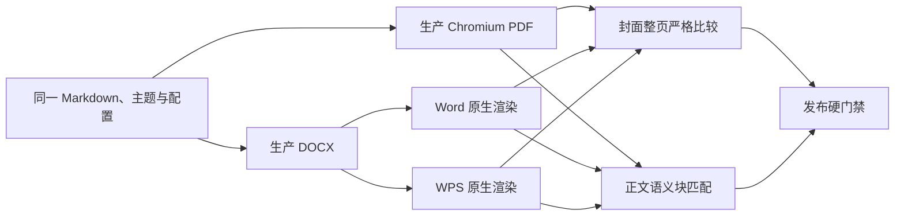

# v0.6.1 DOCX 视觉一致性与发布门禁修复设计

状态：范围已冻结，阶段 A、B 已完成，等待阶段 C。

## 1. 版本目标

`v0.6.1` 是针对 `v0.6.0` DOCX 导出质量的维护版本，不新增与 DOCX
无关的产品功能。本版本必须完成：

1. 修复视觉报告失败但总发布门禁仍通过的判定漏洞；
2. 对四套独立封面主题建立 Chromium、Word、WPS 整页严格门禁；
3. 对 14 套内置主题建立与正文分页位置无关的语义块局部视觉门禁；
4. 修复主题样式、封面布局和字体解析、嵌入、回退问题；
5. 对源码服务、Docker Web API 和 Desktop 安装版执行发布后复验。

本版本不要求 Chromium、Word 和 WPS 的正文总页数或分页边界完全一致，
但不允许以排版引擎不同为理由放过封面、字体或语义块样式退化。

## 2. 问题基线

`v0.6.0` 复核确认存在以下门禁缺口：

- 视觉报告中的像素差异、墨迹 IoU、边缘 IoU 等 failure 级问题未进入
  外层发布阻断集合；
- 六个布局视觉场景只覆盖五套主题，未覆盖全部 14 套主题；
- 四套独立封面只覆盖其中两套；
- “独立封面”主要检查 OOXML 分节、页眉页脚、页码重启和字段存在，
  不能代表视觉一致；
- 14 主题样式门禁主要检查 CSS 槽位、令牌和 Word 样式 ID 存在，不能
  代表最终 Word/WPS 呈现一致；
- 字体名称写入 `fontTable.xml`、转换无 warning，均不能证明字体已经解析、
  嵌入并被 Office 实际使用；
- `red-briefing` 在门禁、Docker Web 和用户实际产物中均为零嵌入字体，
  仍以零 warning 通过。

## 3. 验收模型

### 3.1 封面整页硬门禁

适用于 `formal-feasibility`、`tender-business-blue`、`tender-blind` 和
`tender-classic`：

- 封面必须独占一个物理页；
- 所有封面字段只能出现在封面页，正文不得回流到封面页；
- 封面页不显示正文页眉、页脚和页码；
- 字体、字号、字重、颜色、对齐、位置、边框、背景和装饰线必须匹配；
- 整页像素、墨迹 IoU、边缘 IoU 任一 failure 都阻断发布；
- Word 和 WPS 都必须通过，不允许只以二者相互接近替代 Chromium 基线。

### 3.2 正文语义块门禁

正文按稳定内容顺序和语义角色匹配，不按物理页号配对。允许语义块移动到
另一页，但块自身必须保持视觉一致：

| 语义块 | 必须比较 |
| --- | --- |
| 标题、正文 | 字体、字号、字重、颜色、行高、缩进、段距、对齐 |
| 引用、提示框 | 背景、边框、内边距、文字样式 |
| 代码块 | 等宽字体、字号、背景、边框、内边距、换行 |
| 列表 | 编号或项目符号、缩进、悬挂距离、文字样式 |
| 表格 | 总宽度、列宽、边框、底纹、单元格内边距、表头与文字样式 |
| 图片与图表 | 尺寸、宽高比、清晰度、对齐和题注 |

正文整页栅格差异只作为诊断，不作为最终样式结论；没有完成语义块局部比较
的主题不得标记为视觉通过。

### 3.3 字体硬门禁

- 记录 Chromium、DOCX 字体表、嵌入字体部件、Word PDF 和 WPS PDF 的
  实际字体；
- 需要跨环境稳定的字体必须来自许可证允许分发的字体包；
- 应嵌入字体但字体部件为零时直接失败；
- 字体包未应用、字体回退或 Office 未使用目标字体时必须产生阻断错误；
- 字体名称存在但没有字体二进制不得视为通过。

### 3.4 发布链路门禁

同一验收输入必须覆盖：

1. 源码测试服务；
2. 正式 Docker Web API；
3. 正式 Desktop 安装版。

任一底层报告状态为 `failed` 时，总门禁必须失败。只有已经证明属于合法
正文自然分页流动的问题才能降级为 warning；封面、字体、内容、语义块
样式和媒体失败不得降级。

### 3.5 全量配置矩阵

发布门禁不是少量代表用例，而是固定执行 `14 × 2 × 5 = 140` 个排版
场景：

- 14 套内置主题；
- 纵向、横向两个纸张方向；
- 主题默认、标准、紧凑、宽松和非对称装订五组页边距。

“主题默认”必须使用 `marginMode: theme`，验证主题清单中的真实默认值；
即使解析后的数值与某组显式边距相同，也不得去重。其余四组使用显式
`custom` 配置，验证配置覆盖链路。每个场景生成 Chromium PDF、DOCX、
Word PDF 和 WPS PDF，并在报告中保留主题、方向、边距场景、导出链和
渲染引擎维度，不允许用汇总绿灯掩盖单个失败。

场景 ID 固定为 `<theme-id>--<orientation>--<margin-scenario>`。总报告同时
输出机器可读 JSON 和 14 行 × 10 列 HTML 矩阵；每个单元格必须显示通过、
失败或未执行，并链接到 Chromium/Word、Chromium/WPS、Word/WPS 三份
详细报告。完整门禁必须执行 140 个场景后才允许标记 `complete: true`；
单场景筛选只用于开发复现，不能冒充全矩阵结果。

## 4. 实施阶段

1. 阶段 A：修复 failure 聚合策略，补齐四套封面场景和封面正文隔离；
2. 阶段 B：建立跨页无关的语义块观察、匹配、局部栅格和样式比较协议；
3. 阶段 C：建立 14 主题、2 个方向、5 组页边距的 140 场景全量语义块
   矩阵和版本化门限；
4. 阶段 D：逐主题修复封面、正文块样式和字体嵌入；
5. 阶段 E：完成源码、Docker Web、Desktop 安装版发布后复验；
6. 阶段 F：更新版本、发行说明、发布产物、发布提交和 annotated tag。

每个阶段必须先提交真实失败基线，再修复到通过。不得通过删除用例、提高
门限、过滤 failure 或把 failure 改名为 warning 取得绿灯。

## 5. v0.6.1 发布条件

- 14 套主题在纵向、横向和五组页边距下全部生成真实 Chromium PDF、
  DOCX、Word PDF 和 WPS PDF；
- 四套独立封面全部通过整页严格门禁；
- 14 套主题声明支持的语义块全部通过局部视觉门禁；
- 字体解析、嵌入和实际使用结果符合主题预期；
- 源码、Docker Web 和 Desktop 安装版结果一致；
- 单元测试、类型检查、生产构建和 `git diff --check` 通过；
- 发布报告中不存在被忽略的 failure；
- 完成真实 Word/WPS 逐页人工复核后才能发布。

## 6. 最终验收结果

2026-08-04 已完成全部发布条件：

- `14 × 2 × 5 = 140` 个场景全部实际执行，矩阵报告为
  `complete: true`、`gatePassed: true`，阻断失败和诊断失败均为 0；
- 四套独立封面共 40 个方向/边距组合全部通过 Chromium 对 Word/WPS
  整页严格门禁；其余页面按跨页无关的语义块完成视觉比较；
- 通用 CSS 到 OOXML 翻译已覆盖字体、字距、精确行距、段落、列表、表格、
  引用、代码和行内代码连续性，全程未增加按主题 ID 分支；
- Serif、Sans、Mono 三套可分发字体进入同一字体包解析链，140 个场景的
  DOCX 均包含 5 个字体部件，Word/WPS 实际字体使用门禁通过；
- `red-briefing` 已分别从源码服务、正式 Docker Web API 和实际安装的
  Desktop 导出；三份 DOCX 均约 24.17 MB、含 5 个字体部件，并通过真实
  Word/WPS 渲染复核；
- 根级测试、类型检查、生产构建和空白检查通过；Docker 镜像、Desktop
  安装器及免安装 ZIP 已生成。

最终矩阵报告位于 `output/docx-layout-visual-matrix/summary.json`，发行说明
见 [`docs/releases/v0.6.1.md`](releases/v0.6.1.md)。
