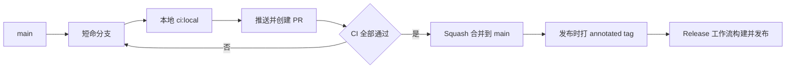
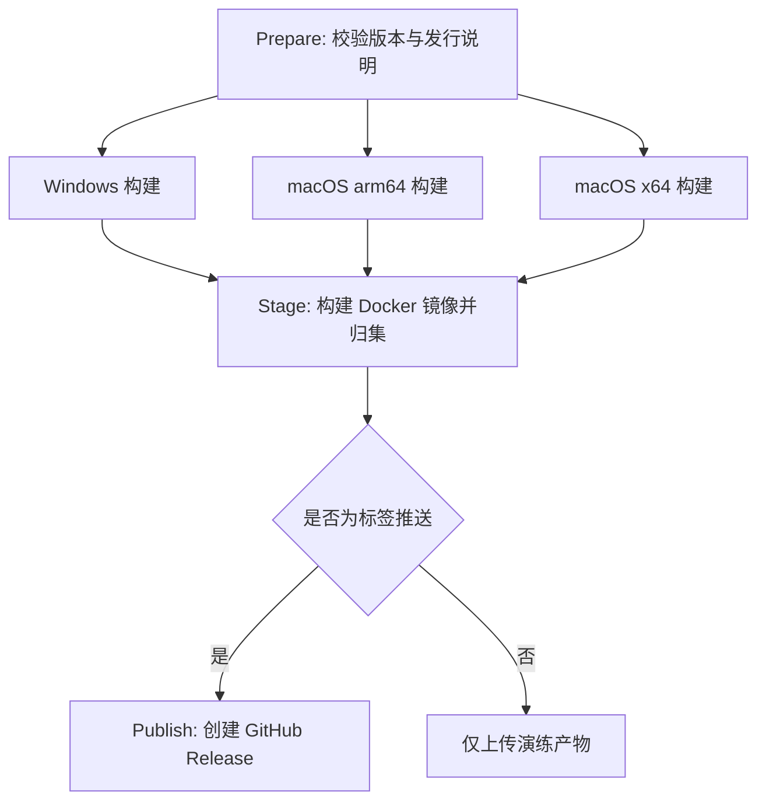

# 开发工作流与 CI/CD

本文说明墨呈（MorphDoc）的分支协作、持续集成、发布流程与分支保护。
提交规范、发版规则等以仓库根目录的 [AGENTS.md](../AGENTS.md) 为准，本文只补充
它们在 GitHub Actions 中的落地方式，不另立规则。

## 1. 分支与合并

- `main` 是唯一长期分支，受保护，只接受通过 CI 的 Pull Request。
- 功能、修复、文档和流水线改动都从 `main` 切出短命分支，命名使用
  `feat/*`、`fix/*`、`docs/*`、`ci/*` 等前缀。
- Pull Request 使用 **Squash 合并**，保持 `main` 线性历史；合并提交信息即最终
  提交信息，需符合 [AGENTS.md §8](../AGENTS.md)：英文前缀、简体中文正文。



## 2. 本地验证

环境要求 Node.js 22 或更高版本，pnpm 由 `package.json` 的 `packageManager`
字段锁定（通过 Corepack 使用）。提交前运行：

```text
pnpm run ci:local
```

它依次执行空白检查、依赖安装检查、类型检查、单元测试和生产构建，与 CI 的核心
检查一致，任一步骤失败即终止。可用 `--skip=` 跳过步骤（如
`--skip=build,test`），用 `--list` 查看步骤标识。脚本是纯 Node.js 实现，
不依赖特定 Shell，Windows、macOS、Linux 用法相同。

## 3. 持续集成

工作流文件：[`.github/workflows/ci.yml`](../.github/workflows/ci.yml)。

触发条件：目标为 `main` 的 Pull Request、推送到 `main`，以及手动触发。同一 PR
或同一分支的新运行会取消仍在进行的旧运行。

| 任务名（即状态检查名） | 平台 | 内容 |
| --- | --- | --- |
| `Whitespace Check` | Linux | 与基线比较的 `git diff --check` |
| `Type Check` | Linux | `pnpm run typecheck` |
| `Build` | Linux | `pnpm run build` |
| `Test (ubuntu-latest)` | Linux | `pnpm test` |
| `Test (macos-latest)` | macOS | `pnpm test` |
| `Test (windows-latest)` | Windows | `pnpm test` |
| `Coverage` | Linux | `pnpm run test:coverage`，与阈值比较 |

另有独立的 [`E2E`](../.github/workflows/e2e.yml) 工作流（任务名 `E2E (Linux)`）
和 [`Stability`](../.github/workflows/stability.yml) 工作流，见第 4 节。

说明：

- 空白检查必须与基线比较。刚检出的干净工作区直接执行 `git diff --check`
  永远通过，因此 PR 以 `origin/<目标分支>` 的共同祖先为基线，推送以
  `github.event.before` 为基线。
- 所有任务共用 [`.github/actions/setup`](../.github/actions/setup/action.yml)：
  按 `packageManager` 安装 pnpm，安装 Node.js 22，执行
  `pnpm install --frozen-lockfile`；测试任务额外安装 Playwright Chromium。
- 依赖 Microsoft Word、WPS 的视觉验证脚本只能在装有 Office 的机器上执行，
  不在 CI 范围内。

## 4. 测试体系

### 4.1 覆盖率棘轮

```text
pnpm run test:coverage            运行覆盖率并与阈值比较，低于阈值则失败
node scripts/coverage.mjs --update  按实测抬高阈值
```

- 脚本直接解析根 `test` 脚本里的 `--filter <包> run test|build` 序列，把
  `run test` 替换为带覆盖率的 vitest。包的构建顺序因此只有 `test` 脚本一处事实
  来源，不要在别处另写一份。
- 阈值保存在 `coverage-thresholds.json`，按实测下浮 1 个百分点锁定，`--update`
  **只升不降**。覆盖率提高后运行一次 `--update` 并提交，阈值就随之抬高。
- 统计范围是各包 `src/**` 下的 `.ts`、`.tsx`，不通过缩小范围美化数字。`web` 与
  `desktop` 的单元测试覆盖率较低（约 25%），因为界面与 Electron 主进程代码依赖
  真实浏览器或窗口，这部分由 E2E 补充。

### 4.2 稳定性检测

```text
pnpm run test:stability            重复 5 次
node scripts/stability.mjs --runs 10
```

重复运行完整测试，区分“只在部分运行中失败”的不稳定用例和“每次都失败”的确定性
失败。`Stability` 工作流支持手动触发（可指定次数），并每周一定时在三个平台上运行。
发现不稳定用例必须定位根因，不要用重试掩盖。

### 4.3 Markdown 夹具与场景覆盖

夹具位于 [`fixtures/markdown`](../fixtures/markdown/README.md)：手写的静态夹具由
`manifest.json` 登记，压力文档与 CRLF、BOM、纯空白变体由确定性生成器在测试时产生。
`packages/renderer/tests/fixture-matrix.test.ts` 对每个夹具及其编码变体断言特性识别、
告警数、确定性与安全性，并要求每个渲染器特性至少被一个夹具覆盖。

测试文件末尾的“已知问题”用 `it.fails` 记录尚未修复的缺陷：缺陷存在时用例
“通过”，缺陷被修复后它会失败，提示删除对应记录。

### 4.4 端到端与视觉基线

```text
pnpm run build:web-runtime && pnpm --filter @morphdoc/server run build
pnpm run test:e2e
```

`e2e/` 用 Playwright 启动真实应用栈，加载夹具并断言预览帧内的真实结构，同时验证
恶意输入不执行脚本。以预览帧的 `rendering`、`rendered` 消息判断渲染稳定，不使用
固定睡眠；不重试。

**视觉基线只在 Linux 上比对。** 不同系统的字体栅格化不同，跨平台比较会持续误报，
因此视觉用例在其他系统上自动跳过，`.gitignore` 也排除了 darwin、win32 的基线。

更新视觉基线：

1. 在 GitHub 的 Actions 页面手动运行 `E2E` 工作流，勾选“重新生成视觉基线”。
2. 下载运行产物 `e2e-screenshots`，解压到 `e2e/__screenshots__/`。
3. **人工审阅图片**确认变化符合预期后提交。

缺少基线时 Playwright 的默认行为是写入实际图片并让该用例失败，不会悄悄通过；只有
手动触发并勾选“重新生成视觉基线”才会覆盖已有基线。

**入库前必须逐张目视审阅**。基线一旦入库，就等于声明“这样渲染是对的”；如果图里
已经有错误（比如被裁切、元素缺失），之后的比对会把错误当作正确。截图的视口高度要
足够容纳整页 A4（预览滚动容器的可见高度 = 视口高度 − 211px），否则基线只覆盖页面
上半部分。

## 5. 发布流程

工作流文件：[`.github/workflows/release.yml`](../.github/workflows/release.yml)。

### 5.1 发布前准备

1. 同步更新根 `package.json` 与 `apps/desktop/package.json` 的版本号，两者必须
   一致；桌面产物文件名取自后者，归集脚本取自前者，工作流会校验。
2. 编写 `docs/releases/v<version>.md`，它将作为 GitHub Release 正文。
3. 更新 `CHANGELOG.md` 与 `docs/PROGRESS.md`。
4. 通过 Pull Request 合并。合并提交即发布提交，信息使用 `release:` 前缀，
   简体中文正文需完整列出新增能力、问题修复、兼容性或部署变化、验证结果和
   发布产物，不得只写版本号。

### 5.2 打标签并发布

在发布提交上创建 annotated tag，说明与发布提交正文保持一致，然后推送：

```text
git tag -a v<version> -F <说明文件>
git push origin v<version>
```

### 5.3 工作流做了什么



- **Prepare**：校验两处版本一致且为合法语义版本；标签发布时还校验标签等于
  `v<version>`、`docs/releases/v<version>.md` 存在。
- **构建**：Windows 执行 `desktop:make`，macOS 分别执行
  `desktop:make:mac:arm64` 与 `desktop:make:mac:x64`。x64 在 Intel runner 上构建，
  因为 Pandoc 运行时准备脚本会在构建机上实际运行目标架构的二进制做冒烟。
- **Stage**：下载四个桌面产物并确认齐全，用官方 Compose 路径执行
  `docker compose build --pull --no-cache`，再由 `scripts/stage-release.mjs`
  归集为 `release/v<version>/`，生成部署 ZIP、离线镜像、`manifest.json` 与
  `SHA256SUMS.txt`。
- **Publish**：只在标签推送时运行，单独持有 `contents: write` 权限，使用
  runner 预装的 `gh release create`，不引入第三方发布 action。

### 5.4 发布演练

修改发布相关文件（工作流、归集脚本、桌面打包配置、`deploy/`）的 Pull Request，
以及手动触发，都会完整执行构建与归集，但**不会**执行 Publish，产物仅保留
3 天。版本号提升会改动 `apps/desktop/package.json`，因此发版 PR 会自动触发
一次演练。

注意两点：

- `pull_request` 的路径过滤按**整个 PR 相对基线的累计改动**判断，而不是按单次推送。
  PR 一旦改过上述任一文件，之后每次推送（哪怕只改了文档）都会重新触发完整演练。
- 演练在 PR 上带有 `cancel-in-progress`，新的推送会取消旧演练。因此要让最终提交获得
  一次完整演练，最后一次推送之后不要再有改动。

### 5.5 产物

| 产物 | 说明 |
| --- | --- |
| `MorphDoc-<version>-x86_64-Setup.exe` | Windows 安装器 |
| `MorphDoc-<version>-x86_64.zip` | Windows 免安装包 |
| `MorphDoc-<version>-arm64.dmg` | macOS Apple Silicon |
| `MorphDoc-<version>-x64.dmg` | macOS Intel |
| `MorphDoc-Web-<version>-image.tar.gz` | Docker 离线镜像 |
| `MorphDoc-Web-<version>-deploy.zip` | Compose 部署包 |
| `manifest.json`、`SHA256SUMS.txt` | 机器可读清单与校验和 |

当前桌面产物均未做代码签名，macOS 首次打开需要在系统设置中手动放行。

### 5.6 失败处理

- 构建失败：修复后重新推送 PR 或重新运行失败任务，演练不产生任何发布。
- Publish 失败且 Release 已部分创建：先用 `gh release delete <tag>` 删除，
  再重新运行 Publish 任务。标签本身不需要重建。
- 已发布版本的发布目录不可覆盖，归集脚本检测到同版本目录存在会直接失败。

## 6. 分支保护

当前由单人维护，规则按此设计；增加协作者后应把 Require approvals 提升到 1。

| 规则 | 设置 | 说明 |
| --- | --- | --- |
| 合并前必须通过 Pull Request | 开启 | 禁止直接推送 `main` |
| Require approvals | **0** | 单人维护时设为 1 会导致无法合并自己的 PR |
| 新提交使旧批准失效 | 开启 | 增加协作者后生效 |
| 必须通过状态检查 | 开启 | 见下方列表 |
| 合并前分支需为最新 | 开启 | 避免基于过期基线合并 |
| 合并前必须解决所有对话 | 开启 | |
| 要求线性历史 | 开启 | 与 Squash 合并一致 |
| 包括管理员 | 开启 | 管理员同样不能绕过 |
| 禁止强制推送与删除 | 开启 | |

必需的状态检查（名称必须与工作流中的任务名完全一致，并且已经运行过一次才能在
设置中选择）：

- `Whitespace Check`
- `Type Check`
- `Build`
- `Test (ubuntu-latest)`
- `Test (macos-latest)`
- `Test (windows-latest)`
- `Coverage`
- `E2E (Linux)`

`E2E` 工作流在每个 PR 上都会运行（没有路径过滤），所以可以安全地设为必需检查。
**不要**把 Release 工作流的任务设为必需检查：它带路径过滤，未触发时检查会一直
处于等待状态，从而阻塞所有不涉及发布文件的 PR。`Stability` 只在手动或定时触发，
同样不能设为必需。

配置路径：仓库 `Settings → Branches`（或 `Settings → Rules`）为 `main` 建立规则；
也可以使用 GitHub CLI 通过
`gh api -X PUT repos/<owner>/<repo>/branches/main/protection` 提交等价配置，
便于复现与审计。临时需要绕过时，先关闭"包括管理员"，操作完成后立即恢复。

## 7. 常见问题

**CI 失败了怎么办？** 先看失败任务日志；本地执行 `pnpm run ci:local`
复现；空白检查失败可用 `git diff --check <基线>` 定位行号。

**能否跳过 CI？** 不建议。受保护的 `main` 要求所有必需检查通过才能合并，
`[skip ci]` 会使必需检查缺失而无法合并。

**如何在本地验证打包？**

```text
pnpm run desktop:package
pnpm run desktop:make
docker compose -f deploy/compose.yaml build
```

`desktop:package` 只生成未打包目录，`desktop:make` 才生成安装器与压缩包。
