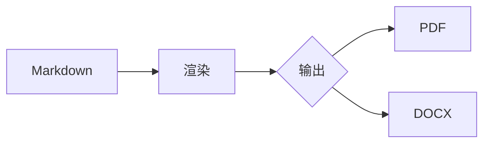
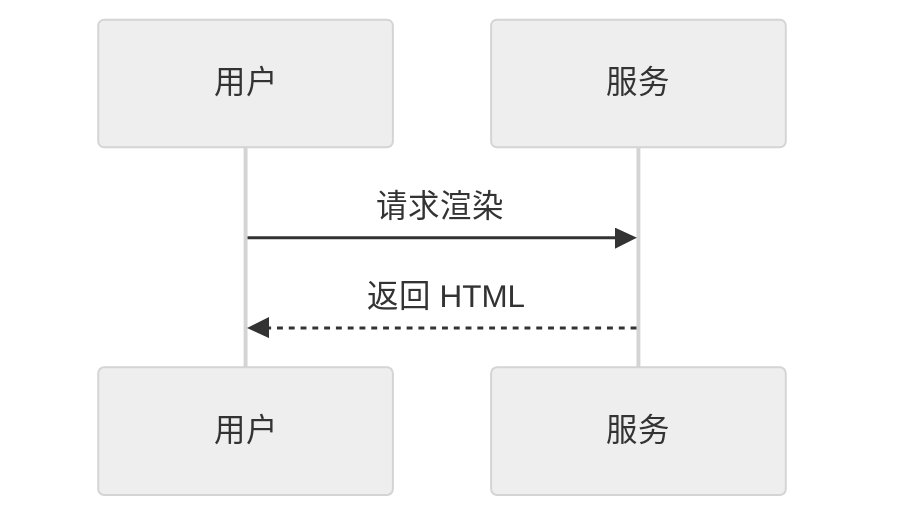

# 图表

## Mermaid 流程图



## Mermaid 时序图（带配置）



## ECharts 柱状图

```echarts
caption: 季度销量
height: 80mm
option:
  xAxis:
    type: category
    data: [Q1, Q2, Q3, Q4]
  yAxis:
    type: value
  series:
    - type: bar
      data: [120, 200, 150, 180]
```
