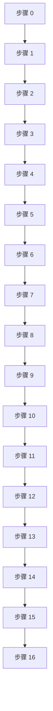

# 连续标题加整页媒体

本文档用于验证连续标题紧接整页高的图表或流程图：整串标题必须与媒体同页，媒体块不能被重复渲染，Paged.js 不能报 “Unable to layout item”。开头先放一段说明文字。

## 超高图表

### 图 1 整页图表

```echarts
version: 1
height: 400mm
caption: 图 1：超高图表
option:
  xAxis:
    type: category
    data: [甲, 乙, 丙, 丁]
  yAxis:
    type: value
  series:
    - type: bar
      data: [4, 2, 8, 1]
```

图表后紧跟的正文一。

## 超高流程图

### 流程图 1



流程图后紧跟的正文二。

最后一段正文。
