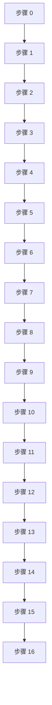

# 超高媒体

本文档用于验证被缩放到整页的图片、图表和流程图：它们之后的内容必须从下一页开始。每个整页媒体之前只有一个标题，连续标题的情形见 heading-chain-media.md。开头先放一段说明文字，避免“标题紧接整页图”这一特例。

### 超高图片

图前的说明段落，用来改变整页图在页面中的起始位置。这一段稍长，占据两行左右的版面。

![一张又细又高的图]()

图后紧跟的正文一：这一段必须从图所在页的下一页开始。

### 图 1 整页图表

```echarts
version: 1
height: 400mm
caption: 图 1：超高图表
option:
  xAxis:
    type: category
    data: [甲, 乙, 丙, 丁]
  yAxis:
    type: value
  series:
    - type: bar
      data: [4, 2, 8, 1]
```

图表后紧跟的正文二：这一段必须从图表所在页的下一页开始。

### 图 2 整页图表

```echarts
version: 1
height: 380mm
caption: 图 2：超高图表
option:
  xAxis:
    type: category
    data: [甲, 乙, 丙, 丁]
  yAxis:
    type: value
  series:
    - type: bar
      data: [5, 4, 9, 2]
```

图表后紧跟的正文三：这一段必须从图表所在页的下一页开始。

### 流程图 1



流程图后紧跟的正文四：这一段必须从流程图所在页的下一页开始。

最后一段正文，用来确认文档末尾没有多余的空白页。
