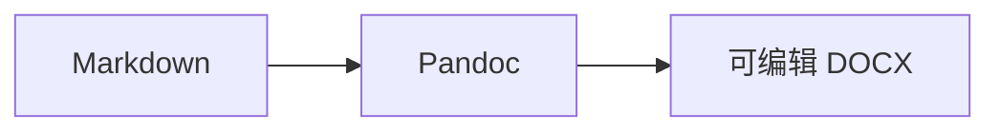

# 一级标题：可编辑文档

这是一段可编辑的中文正文，包含 **加粗文本**、*斜体文本*、
~~删除线文本~~、`inlineCode()` 和
[外部链接](https://example.invalid/docx-acceptance)。

## 二级标题：段落结构

> 引用段落用于确认内容仍是 Word 原生段落，而不是页面截图。

- 无序列表第一项
  - 嵌套无序列表
- 无序列表第二项

1. 有序列表第一项
2. 有序列表第二项

- [x] 已完成任务
- [ ] 未完成任务

### 三级标题：表格与代码

| 验收项 | Word 结构 | 预期结果 |
| :--- | :---: | ---: |
| 正文 | 段落与文本 Run | 可编辑 |
| 表格 | 原生表格与单元格 | 可增删内容 |
| 图表 | 高分辨率 PNG | 可调整图片 |

```typescript
export function editableDocument(value: string) {
  return `DOCX 内容仍可编辑：${value}`;
}
```

脚注引用仍应保留原生结构。[^editable-footnote]

行内公式 $E = mc^2$ 与块级公式：

$$
\int_0^1 x^2\,dx = \frac{1}{3}
$$




```echarts
version: 1
caption: ECharts 柱状图
option:
  xAxis:
    type: category
    data: [一月, 二月, 三月]
  yAxis:
    type: value
  series:
    - type: bar
      data: [12, 20, 16]
```

最后一段用于确认正文没有通过 `altChunk` 嵌入 HTML，也没有整体图片化。

[^editable-footnote]: 这是可以继续编辑的 Word 原生脚注。
