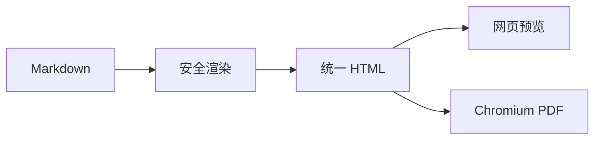

# 内网文档渲染服务接入指南

GitHub 主题适合技术说明、接口文档和包含大量代码的工程资料。本示例
覆盖代码围栏、表格、引用和 Mermaid。

## 渲染流程



## 请求示例

```ts
const response = await fetch("/api/render", {
  method: "POST",
  headers: {
    "content-type": "application/json"
  },
  body: JSON.stringify({
    markdown: "# 示例",
    language: "zh-CN"
  })
});

if (!response.ok) {
  throw new Error("渲染失败");
}
```

## 接口约束

| 项目 | 限制 |
| --- | --- |
| 原始 HTML | 默认不执行 |
| 远程资源 | PDF 阶段禁止外部网络 |
| 相对图片 | Desktop 从文档目录安全读取 |
| 图表 | 等待渲染完成后再分页 |

> 精确预览与最终 PDF 使用同一份 Chromium 结果；快速预览用于编辑期间的
> 即时反馈。

## 检查清单

- [x] 返回可搜索文本
- [x] 主题资源使用同源地址
- [x] Mermaid 采用严格安全模式
- [ ] 根据部署规模调整 PDF 并发上限
